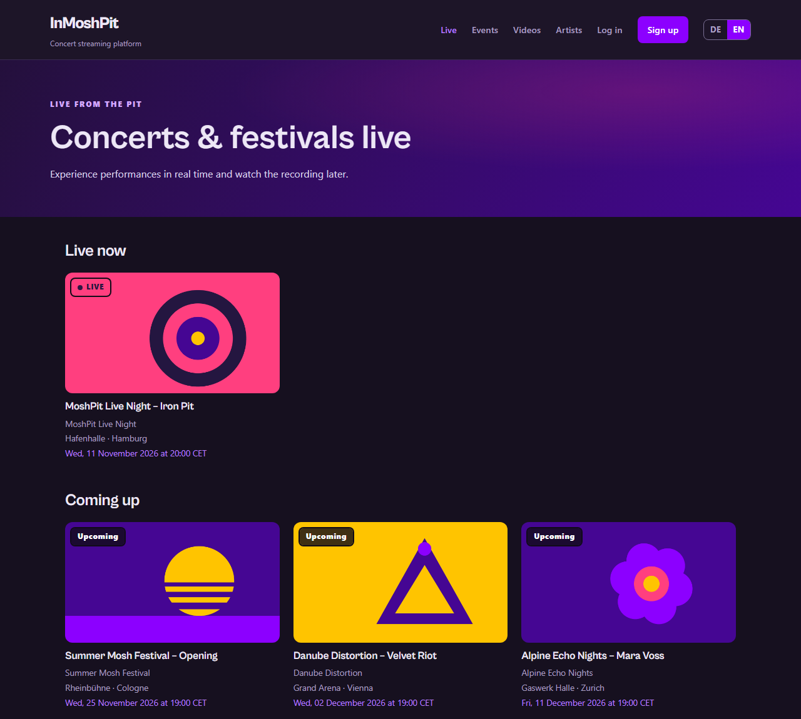
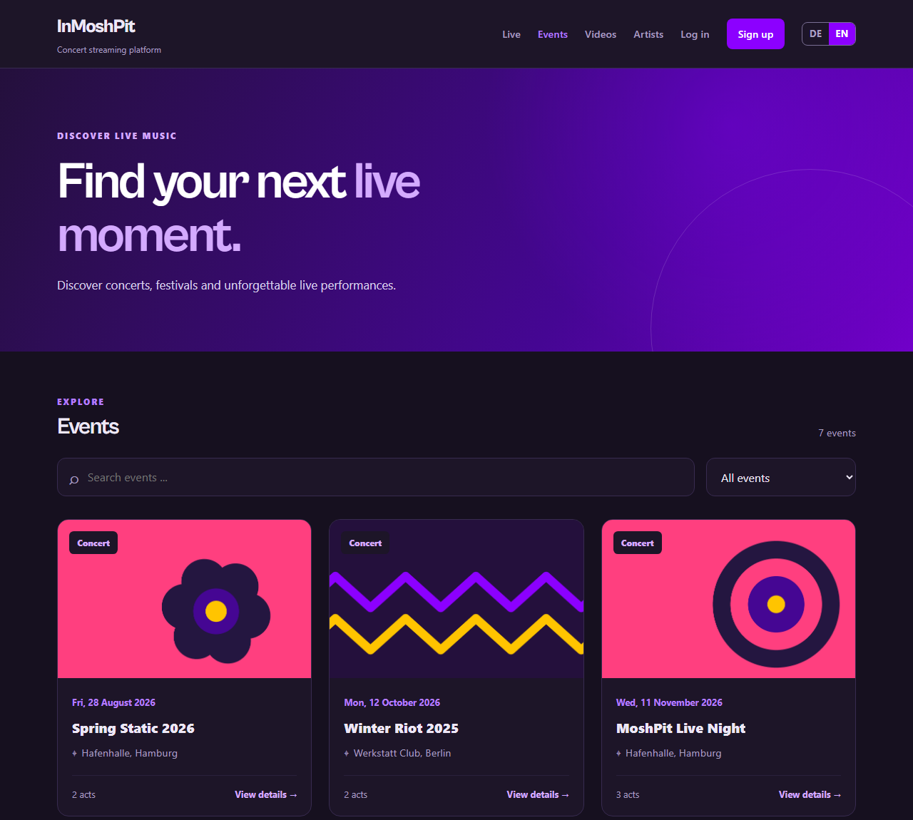
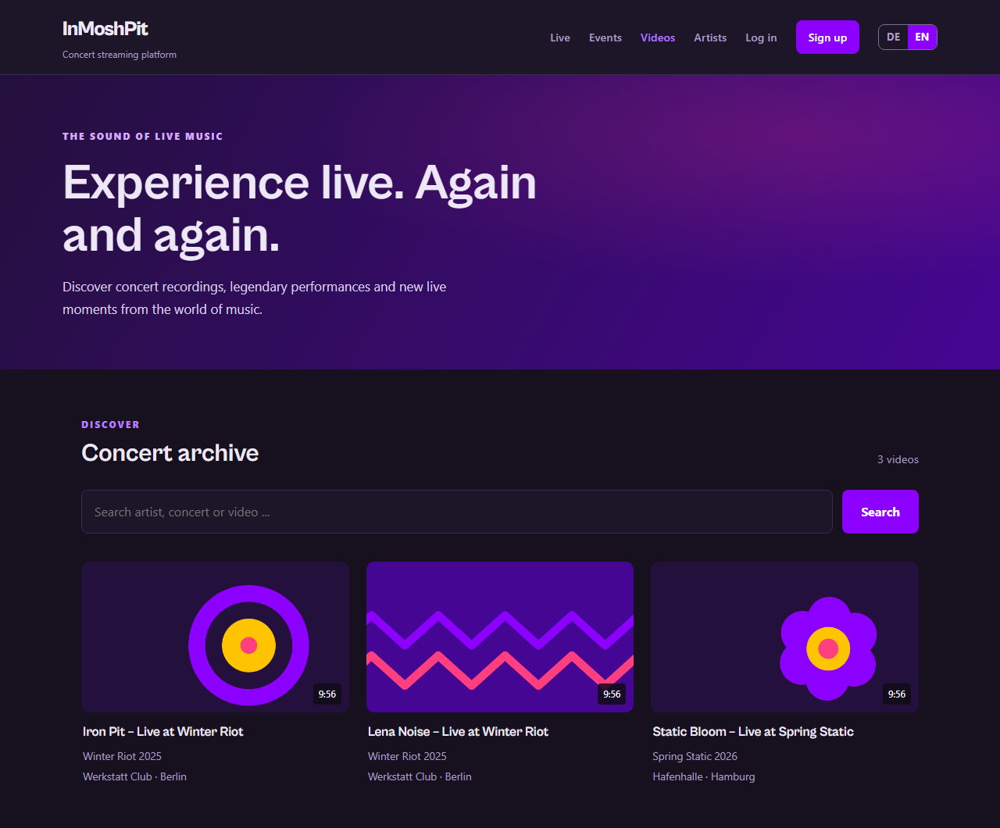
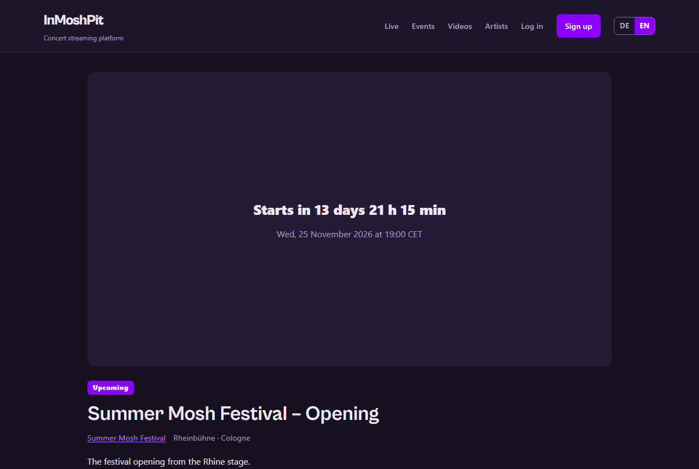

# InMoshPit

Concert streaming platform: watch live concerts and festivals, then catch up
with the recordings. Available in German and English.

## Features

- Live streams with countdown, status updates and HLS playback
- Recordings archive with likes and comments
- Events (concerts, festivals) with line-up and stages, artists and bands
- Registration and JWT login
- DE/EN language switcher

## Screenshots

<table>
  <tr>
    <td width="50%" valign="top"><br><sub>Live streams: live now and coming up</sub></td>
    <td width="50%" valign="top"><br><sub>Concerts and festivals in several cities</sub></td>
  </tr>
  <tr>
    <td width="50%" valign="top"><br><sub>Recordings archive</sub></td>
    <td width="50%" valign="top"><br><sub>Countdown for an upcoming stream</sub></td>
  </tr>
</table>

## Stack


## Getting started

Requires Python 3.13+ and Node.js 20.19+ (or 22.12+).

**Backend** (http://127.0.0.1:8002)

```powershell
cd backend
python -m venv .venv
.venv\Scripts\activate
pip install -r requirements.txt
python manage.py migrate
python manage.py seed_demo        # demo venues, acts, events, streams, videos and covers
python manage.py runserver 8002
```

**Frontend** (http://localhost:5173)

```powershell
cd frontend
npm install
copy .env.example .env             # local config, not committed
npm run dev
```

Create an admin user with `python manage.py createsuperuser` to manage
content at `/admin/`.

## Configuration

Local development needs no configuration. For any other environment, set these
environment variables for the backend (nothing secret is stored in the repo):

| Variable | Purpose |
|---|---|
| `DJANGO_DEBUG` | `0` turns debug mode off (default: on) |
| `DJANGO_SECRET_KEY` | **Required** when debug is off |
| `DJANGO_ALLOWED_HOSTS` | Comma-separated host names |
| `DJANGO_CORS_ALLOWED_ORIGINS` | Comma-separated frontend origins |

Before going live also run `python manage.py check --deploy` (HTTPS settings,
a real email backend) and use PostgreSQL instead of SQLite.

## Tests

```powershell
cd backend ; python -m pytest
cd frontend ; npm run test:run
```

## Status

Early MVP. Not yet included: ingest for real live streams (RTMP to HLS),
FFmpeg processing of uploaded recordings, live chat, and a content management
UI beyond the Django admin.
